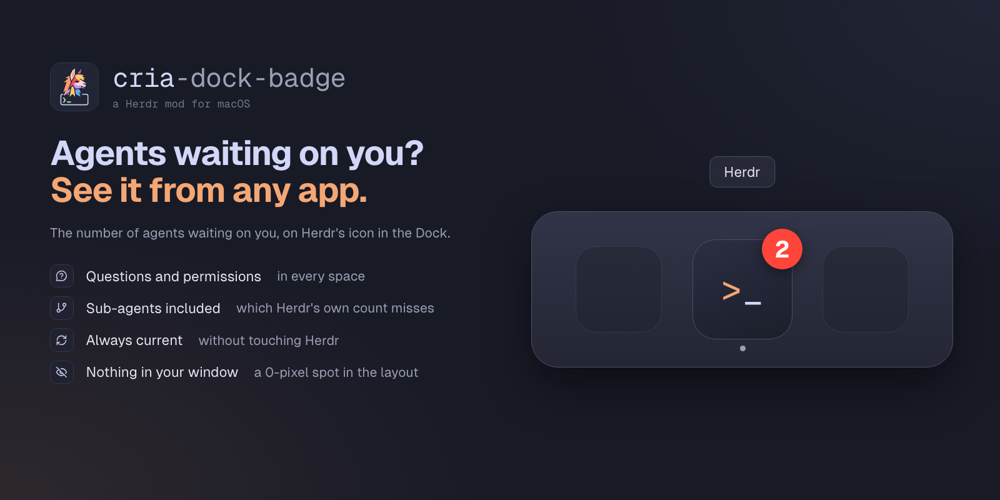

# cria-dock-badge

A [Herdr](https://herdr.dev) mod for macOS: the number of agents waiting on you, on Herdr's icon in the Dock. You see from any app when an agent needs an answer or a permission, sub-agents included.



## Features

- **The count:** every agent waiting on you, in every space: an agent asking a question or a permission. Sub-agents count too, which Herdr's own "needs you" in its status bar leaves out.
- **No number** when none waits.
- **Always current:** it updates the moment an agent starts or stops waiting, without you touching Herdr.
- **Nothing in the window:** the mod takes a 0-pixel spot in your layout. Switching to a layout without it clears the number, so it never shows a stale count.

## Install

Ask your agent in Herdr to add `herdr.dev/mods/gsydler/herdr-cria--dock-badge`, or copy `mods/cria-dock-badge/` (in this folder) into `~/.config/herdr-app/mods/`. Then check it:

```sh
herdr-app check ~/.config/herdr-app/mods/cria-dock-badge
```

Herdr runs a mod only while it has a spot in your layout, so the mod needs one line there, which the installing agent offers to add. In a column or row with no `gap` and no `divider` (the `work` column in Herdr's own layout):

```json
{ "id": "dock-badge", "type": "block", "content": { "mod": "cria-dock-badge" }, "size": { "px": 0 } }
```

If your layout is one of Herdr's, the agent clones it first: Herdr replaces its own layouts on every start. `RECIPE.md` ("Install") has the steps, and how to undo them.

Another mod that also sets the Dock badge competes with this one: the last to set it wins. Keep one.

## What it does on your computer

Herdr asks you to know this before adding a mod:

- **Sets the badge** on Herdr's Dock icon. Nothing else.
- **Runs no programs**, **never reaches the network**, and **reads or writes no files**.

## Platforms

- **macOS:** everything.
- **Linux and Windows:** Herdr has no app badge there yet, so the mod does nothing. If Herdr adds one, the mod shows the count with no change.

## Development

This folder is one entry of the [herdr-cria](../README.md) repo, which holds the tooling shared by all its mods. Run these from the repo's top folder:

```sh
node --test 'dock-badge/tests/*.test.mjs'   # what counts, and what the badge says
node scripts/check-herdr.mjs dock-badge      # Herdr's requirements for a shared mod (CI checks every entry)
herdr-app check dock-badge/mods/cria-dock-badge   # loads and renders the mod; needs the app
scripts/banner.sh dock-badge                 # renders preview.png from assets/banner.html; needs Brave, Chrome or Chromium, and the internet for the fonts
```

Changes are listed in [CHANGELOG.md](CHANGELOG.md); releases are tagged `dock-badge/vX.Y.Z`.

## License

[Apache-2.0](../LICENSE).
