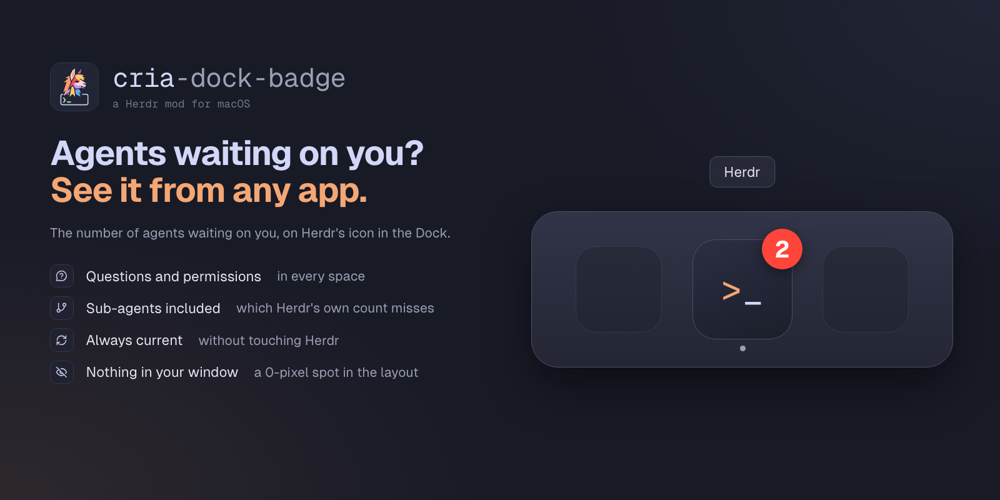

# Cria dock badge

The number of agents waiting on you, on Herdr's icon in the macOS Dock: an agent asking a question or a permission counts, sub-agents included, in every space. With none waiting, the icon has no number. It draws nothing in Herdr's window: it takes a 0-pixel spot in your layout, which keeps it running. macOS only.



This file is the brief: enough to build Cria dock badge from an empty folder. The files next to it are one build of it. If they don't work on your Herdr, or you want it different, build it again from here.

## What you see

- **The Dock icon:** macOS's red badge on Herdr's icon, with the number of agents waiting on you ("1", "2", "12"). With none waiting, no badge.
- **The window:** nothing. The mod's spot in the layout is 0 pixels, and it draws an empty `div()`.

## How it behaves

There are no animations; the badge is the mod's only output.

- **What counts:** every terminal Herdr lists (`terminals()`) whose status is `blocked`, which is how an agent reports that it needs the person: a question or a permission. Sub-agents count too: they run inside their parent's pane, and `agents()`, which lists one terminal per pane, leaves them out. `working`, `done`, `idle`, `error` and terminals with no status don't count.
- **When it updates:** at each redraw. Herdr redraws the mod when an agent's status changes, so the badge follows within a moment, without the person touching Herdr. It calls `setBadge` only when the text changes.
- **Switching layouts:** a layout without the mod clears the badge (its `close()` does), so it never shows a stale count. Switching to another layout that has the mod keeps the badge.
- **Other platforms:** Herdr ignores the badge on Linux and Windows, so there the mod does nothing.

## Install: put it in your layout

The mod is `"place": "none"`: copying it in shows nothing and counts nothing. Herdr runs a mod only while it has a spot in the shown layout, and a hidden spot never starts it. After the usual install steps:

1. **Find the layout.** `herdr-app status` names the shown layout: `~/.config/herdr-app/layouts/<layout>.json`.
2. **Make it editable.** If it is Herdr's (`main`, `terminals`, `win98`): `herdr-app do layout.clone '{"name":"<layout>","as":"<layout>-badge"}'`, which switches to the clone. Herdr's layouts are replaced on every start.
3. **Add the spot** as the last child of a `column` or `row` that has no `gap` and no `divider` (in Herdr's `main` layout, the `work` column):

   ```json
   { "id": "dock-badge", "type": "block", "content": { "mod": "cria-dock-badge" }, "size": { "px": 0 } }
   ```

   A container with a `gap` would add that space beside the empty spot, and one with a `divider` a line.
4. `herdr-app check ~/.config/herdr-app/mods/cria-dock-badge`, and the layout shows no error in `herdr-app status`.

Undo: remove the block (or `ctrl-shift-l` back to the person's previous layout), and the badge clears.

## Built from

- **One mod**, `mods/cria-dock-badge/`, `mod.json` `{ "place": "none" }`: the person's layout gives it its spot. No `keys.json`, no block props.
- **`main.js`**: a `View` whose `render()` counts, sets the badge when the text changed, and returns `div()`; `close()` clears the badge.
- **Pure module**, unit-tested with `node --test`: `count.js` (`waiting`: the terminals with status `blocked`; `badgeText`: the count as text, `null` for zero).
- **`herdr` functions:** `terminals`, `setBadge`, `checking`.
- **Programs, network, files:** none.

## Watch out

- **What it does on the person's computer:** it sets the badge on Herdr's Dock icon. It runs no programs, never reaches the network, and reads or writes no files.
- `agents()` lists one terminal per pane and misses sub-agents; `terminals()` lists every terminal.
- `setBadge`'s last call wins, whichever mod made it: another mod that sets the badge (a custom tab bar, say) competes with this one. Keep one.
- `herdr-app check` renders the mod for real: `checking()` keeps it from changing the person's Dock while it does.
- A block marked `"hidden": true` never starts its mod: the spot must be shown, at 0 pixels.
- Herdr ignores `setBadge` outside macOS "for now" (`herdr.d.ts`); if it ever shows a badge elsewhere, this mod shows it there with no change.

## Done when

- `herdr-app check mods/cria-dock-badge` passes, and `node --test` passes.
- Each `manual` step in `samples/expected.json` does what it says: the count when an agent and its sub-agent wait, updated without touching Herdr, and cleared in a layout without the mod.
